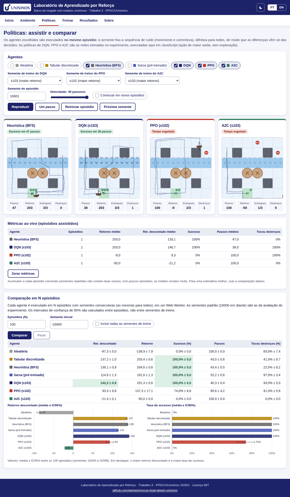
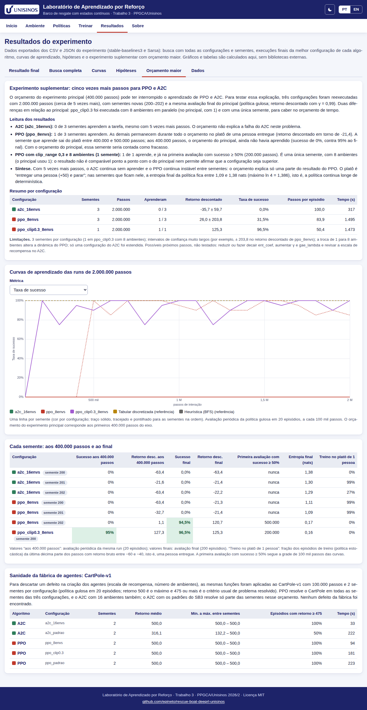

<p align="center"></p>

# Laboratório de Aprendizado por Reforço: barco de resgate com estados contínuos

**Português** · [English below](#english)

[](https://github.com/epineto/rescue-boat-deeprl-unisinos/actions/workflows/test.yml)
[](LICENSE)
[](https://epineto.github.io/rescue-boat-deeprl-unisinos/)

**Demonstração: <https://epineto.github.io/rescue-boat-deeprl-unisinos/>**



## O que é
Aplicação web estática (100% no navegador, sem dependências de execução e sem etapa de build) que acompanha o **Trabalho 3 de Aprendizado por Reforço 2026/2** (PPGCA/Unisinos). O cenário do Trabalho 2 (barco de resgate 6×6, abrigo H, três pessoas ilhadas, capacidade 2, correnteza na linha 2, destroços e quatro blocos) foi reformulado para **aproximação de função**: posição **contínua**, **ruído** de movimento e **correnteza dinâmica** (intensidade variável no tempo e observável). O problema é resolvido com **DQN, PPO e A2C** (stable-baselines3) e com **Sarsa semi-gradiente linear com *tile coding*** (implementado à mão; Aulas 12 e 13). O laboratório permite:

1. **Controlar o barco** com o teclado (setas ou N, S, L, O) e ver a posição contínua, a ocupação, a intensidade da correnteza, a recompensa acumulada e a observação de 13 números (`#ambiente`).
2. **Assistir às políticas** de DQN, PPO, A2C, Sarsa e das linhas de base (tabular discretizada, heurística, aleatória) **lado a lado, com a mesma semente de ruído**, com métricas ao vivo e comparação em N episódios (Web Worker) (`#politicas`).
3. **Treinar o Sarsa no navegador** (grade, *tilings*, α, ε, γ ajustáveis), com curva de aprendizado ao vivo, e assistir à política aprendida (`#treinar`).
4. **Explorar os resultados** do experimento: busca com **todas** as configurações e sementes, tabela final, curvas de aprendizado com bandas de confiança, hipóteses e o **experimento suplementar de orçamento maior** (PPO e A2C com 2 milhões de passos, mais a sanidade no CartPole-v1), com filtros (`#resultados`).

O núcleo (`src/core/`) reproduz o código Python de `reference/python/barco_continuo.py` (gerador mulberry32 + Box-Muller idêntico) e é verificado contra ele nos testes. O idioma padrão é o português (pt-BR); o botão **EN** troca para inglês; o botão de tema alterna entre claro e escuro (segue o sistema por padrão).

> **Leitura honesta.** O simulador é próprio (sem validação externa), o número de sementes é pequeno (3 na busca e 5 nas execuções finais) e o orçamento de passos é limitado; os intervalos de confiança são largos e os testes de hipótese têm baixo poder. Os resultados são **indicativos**, não definitivos. A linha de base tabular conhece o mapa e o modelo do Trabalho 2, mas ignora o ruído, a posição dentro da célula e a intensidade da correnteza; não é um limite superior. No navegador, o Sarsa usa o mesmo algoritmo e as mesmas características do Python, mas outro gerador de números aleatórios na exploração: as curvas são estatisticamente equivalentes, não idênticas.

## Resultados do experimento
Ambiente contínuo com 13 observações, passo de 0,7 célula, raios de embarque e desembarque de 0,8 e 0,9, correnteza dinâmica observável e episódios de 100 passos. Busca: 200 mil passos × 6 configurações × 3 sementes por algoritmo (inclui os padrões do SB3); a melhor configuração de cada algoritmo foi reexecutada com 400 mil passos × 5 sementes novas. Retorno descontado com γ = 0,99; valores: média ± IC95% entre sementes (algoritmos) ou entre 500 episódios (referências).

| Agente | Configuração | Sementes | Retorno descontado | Sucesso | Toca destroços |
|---|---|---|---|---|---|
| DQN | `dqn_gamma0.95` | 5 | 140,1 ± 1,7 | 99,5% | 89,7% |
| Sarsa (tile coding) | `sarsa_6x6x3_a0.3` | 5 | 111,5 ± 3,7 | 99,7% | 93,3% |
| PPO | `ppo_clip0.3` | 5 | −5,9 ± 75,9 | 15,6% | 18,0% |
| A2C | `a2c_16envs` | 5 | −38,3 ± 28,5 | 0,0% | 0,0% |
| Tabular discretizada (π* do Trabalho 2) | – | referência | 138,5 ± 0,5 | 100,0% | 54,0% |
| Heurística (BFS) | – | referência | 138,9 ± 0,4 | 100,0% | 20,6% |
| Aleatória | – | referência | −90,7 ± 2,4 | 0,0% | 82,8% |

- **Padrões do SB3 não aprendem** (retorno descontado de −63 a −66 em DQN, PPO e A2C): a escala de recompensa × 0,1 (tratada como hiperparâmetro da busca) é decisiva; o DQN sem escala não aprende.
- **H1** (off-policy com repetição de experiência é mais eficiente em amostras que on-policy): **confirmada** (área sob as curvas; DQN contra PPO, *p* = 0,017, e contra A2C, *p* < 0,001).
- **H2** (PPO mais estável entre sementes que A2C): **refutada, em direção contrária**. O A2C é “estável” apenas porque falha em todas as sementes; só 1 das 5 sementes do PPO aprende.
- **H3** (a aproximação de função fica abaixo do ótimo do Trabalho 2): o DQN fica estatisticamente indistinguível da tabular discretizada (diferença de +1,7; **inconclusiva**, *p* = 0,056), mas toca destroços em cerca de 90% dos episódios, isto é, aceita o risco; PPO, A2C e Sarsa ficam **abaixo** das referências.
- **Experimento suplementar (orçamento maior):** com 2 milhões de passos (cinco vezes o orçamento das execuções finais), o A2C continua em **0 de 3** sementes e o `ppo_8envs` em **1 de 3** (a semente que aprende só sai do platô entre 400 e 500 mil passos); `ppo_clip0.3` com 8 ambientes aprende na única semente executada. O platô típico é “entregar uma pessoa (+50) e parar”, com política de alta entropia. A fábrica de agentes foi validada no CartPole-v1 (as três configurações de PPO e o A2C com 16 ambientes chegam a 500 em todas as sementes).

Todas as configurações, sementes e curvas estão em `resultados_completos/` e na seção `#resultados`.



## Seções
Barra fixa no topo, com roteamento por âncora:

| Âncora | O que faz |
|---|---|
| `#intro` | Problema (observação, ações, dinâmica, recompensas), parâmetros calibrados, quem é comparado e atalhos |
| `#ambiente` | Mapa em canvas, controle manual (teclado e botões), medidor da correnteza, recompensa, observação de 13 números |
| `#politicas` | Agentes lado a lado (mesmo ruído), escolha da semente de treino das redes, métricas ao vivo, comparação em N episódios (Web Worker) com IC95% |
| `#treinar` | Sarsa com tile coding no navegador (Web Worker), curva ao vivo, resultado frente às referências, política aprendida em ação |
| `#resultados` | Resultado final, busca completa (filtros, ordenação, sementes), curvas com bandas, hipóteses, orçamento maior (experimento suplementar) e arquivos de dados |
| `#sobre` | Como rodar, testes, aulas relacionadas, limitações e referências |

Roteiro de uso em 20 s por seção: [docs/NAVEGACAO.md](docs/NAVEGACAO.md).

## Como rodar localmente
O app é estático (módulos ES e Web Workers), mas precisa de um servidor HTTP:

```bash
npm run serve            # equivale a: python3 -m http.server 8000
# abrir http://localhost:8000
```

> Abrir `index.html` por `file://` **não funciona**: navegadores bloqueiam módulos ES e Web Workers nesse modo.

O GitHub Pages publica a **raiz** do repositório (branch `main`; todos os caminhos são relativos).

## Testes
```bash
npm test                 # node --test tests/  (Node >= 18; sem dependências)
```
Os testes verificam, contra o Python:

- o **ambiente** em JavaScript contra uma trajetória gerada pelo Python (`tests/trajetoria_referencia.json`: posição, intensidade, recompensa, situação, término; tolerância 1e-9), o gerador mulberry32 e as **linhas de base** de 500 episódios (tabular, heurística e aleatória; `tests/linhas_de_base_referencia.csv`), além do MDP discreto do Trabalho 2 (V*(s₀) = 161,93 e a política ótima em todos os 832 estados);
- o **tile coding** (5 configurações × 200 pontos) e a **regra de atualização do Sarsa** (1.500 passos) contra o Python (`tests/reference.json`, gerado por `tools/gen_reference.py`), e o treino no navegador (aprende a resgatar nas 3 pessoas);
- a **inferência das redes** contra o PyTorch: observações fixas e saídas de cada modelo exportado (`data/paridade.json`) e MLPs sintéticos (ReLU e tanh);
- a **carga dos dados** (`data/`), a agregação feita no navegador contra `busca_resumo.csv`, a comparação em N episódios e a leitura de números com vírgula ou ponto; o **carregamento do experimento suplementar** (com e sem os arquivos `extra_*.csv`, resumo contra a agregação das runs, valor aos 400 mil passos contra a curva e as afirmações do texto da aba conferidas nos dados);
- os **dicionários PT/EN** (mesmas chaves e marcadores, todas as chaves usadas existem, texto padrão do HTML igual ao dicionário) e a **voz impessoal** dos textos.

A integração contínua (`.github/workflows/test.yml`) roda `npm test` com Node 20 a cada push.

## Dados e como regenerá-los
`data/` é **gerada** pelo script `tools/exportar_para_lab.py` a partir da pasta de resultados do experimento (`experimentos_t3.py`); o script é idempotente (mesma entrada, mesmos bytes) e substitui todo o conteúdo de `data/`:

```bash
cd lab
python tools/exportar_para_lab.py          # execução final (usa ../resultados)
```

Entradas: `runs/*.json`, `modelos/final_*.zip`, `linhas_de_base.csv`, `melhores_configs.json`, `info.json`, `hipoteses.csv`, `auc_curvas.csv` e `extra/*.csv` (experimento suplementar). Saídas: `indice.json`, CSV enxutos (`busca_runs`, `busca_resumo`, `final_runs`, `final_resumo`, `curvas_*`, `linhas_de_base`, `hipoteses`, `auc_curvas`, `extra_runs`, `extra_resumo`, `extra_curvas`, `cartpole_runs`, `cartpole_resumo`), pesos das redes em JSON (`modelos/`), pesos esparsos do Sarsa e `paridade.json`. O Sarsa não salva pesos no experimento: o script o **retreina de forma determinística** (mesmo código, semente e orçamento da melhor execução final) e confere o resultado contra o JSON da execução. Requer o ambiente Python do experimento (torch, stable-baselines3, gymnasium).

Para regenerar apenas os arquivos do experimento suplementar (sem retreinar o Sarsa nem tocar nos demais), usa-se `python tools/exportar_para_lab.py --so-extra`; o resultado é idêntico ao da exportação completa. As entradas (`runs/`, `modelos/`) fazem parte do projeto do experimento e **não** estão neste repositório; os resultados completos em CSV/JSON e os modelos finais do SB3 estão em `resultados_completos/` e o código do experimento em `codigo/`.

Detalhes e passo a passo: [docs/REPRODUCAO.md](docs/REPRODUCAO.md).

## Estrutura
```
index.html  style.css  404.html  manifest.webmanifest
assets/      logo, ícones, imagem social
data/        gerada por tools/exportar_para_lab.py (CSV, JSON, modelos/)
resultados_completos/   CSV e JSON completos do experimento (busca, finais, hipóteses, suplementar) e README da pasta
codigo/      código do experimento: barco_continuo.py, experimentos_t3.py, experimento_extra_t3.py, testes_ambiente.py, requirements_t3.txt
src/core/    rng, env, mdp_t2, politicas, mlp, sarsa (tile coding), avaliar, comparar, dados, estat, numeros
src/ui/      interface por seção, gráficos em canvas, desenho do mapa; src/worker.js e src/worker-treino.js
src/i18n/    pt.js e en.js
tests/       testes (node --test), reference.json, trajetória e linhas de base de referência
reference/   python/barco_continuo.py (cópia do ambiente e algoritmos do experimento)
docs/        REPRODUCAO.md, NAVEGACAO.md, img/
tools/       exportar_para_lab.py, gen_reference.py, capturas.py, gerar_og.py
```

## Créditos e licença
Epitácio Vicente do Nascimento Neto e Antonio Clerton Santana de Araujo, Programa de Pós-Graduação em Computação Aplicada (PPGCA), Unisinos. Disciplina Aprendizado por Reforço 2026/2, Prof. Dr. Gabriel de Oliveira Ramos. Código sob licença [MIT](LICENSE). Como citar: [CITATION.cff](CITATION.cff).

Referências: Sutton e Barto, *Reinforcement Learning: An Introduction* (2018); Raffin et al., Stable-Baselines3 (*JMLR*, 2021); Mnih et al., DQN (*Nature*, 2015); Schulman et al., PPO (arXiv:1707.06347, 2017); Mnih et al., A3C (*ICML*, 2016); Towers et al., Gymnasium (2024).

---

# English

**Reinforcement Learning Lab: rescue boat with continuous states.** A static web app (100% in the browser, no runtime dependencies, no build step) that accompanies Reinforcement Learning Assignment 3 (PPGCA/Unisinos, 2026/2). The 6×6 rescue-boat scenario of Assignment 2 was reformulated for **function approximation** (continuous position, movement noise, an observable dynamic current) and solved with **DQN, PPO and A2C** (stable-baselines3) and a hand-written **semi-gradient Sarsa with tile coding**. Click **EN** in the header for the English interface; the moon/sun button switches the light/dark theme.

| Anchor | What it does |
|---|---|
| `#intro` | The problem, calibrated parameters, who is compared |
| `#ambiente` | Drive the boat (arrow keys or N, S, E, W): continuous position, occupancy, current gauge, reward, the 13-number observation |
| `#politicas` | Watch DQN, PPO, A2C, Sarsa and the baselines side by side on the same noise seed; live metrics; N-episode comparison in a Web Worker |
| `#treinar` | Train Sarsa with tile coding in the browser (grid, tilings, α, ε, γ), live learning curve, watch the learned policy |
| `#resultados` | Final table, **every** search configuration, learning curves with confidence bands, hypotheses, larger-budget supplementary experiment |
| `#sobre` | How to run, tests, related lectures, limitations, references |

**Run locally:** `npm run serve`, then open <http://localhost:8000> (a static HTTP server is required; `file://` does not work). **Test:** `npm test` (Node 18+, no dependencies). **Regenerate `data/`:** `python tools/exportar_para_lab.py` (see [docs/REPRODUCTION.md](docs/REPRODUCTION.md)). The JavaScript environment, tile coding, the Sarsa update and the network inference are tested against Python/PyTorch.

**Results (final runs, discounted return, 95% CI across seeds; success rate):** DQN `dqn_gamma0.95` 140.1 ± 1.7 (99.5%); Sarsa 6×6×3 α0.3 111.5 ± 3.7 (99.7%); PPO `ppo_clip0.3` −5.9 ± 75.9 (15.6%, only 1 of 5 seeds learns); A2C `a2c_16envs` −38.3 ± 28.5 (0%). References: discretized tabular 138.5, heuristic 138.9, random −90.7. SB3 defaults do not learn (the ×0.1 reward scale is decisive). H1 (off-policy more sample-efficient) **confirmed**; H2 (PPO more stable than A2C) **refuted in the opposite direction** (A2C is “stable” only because it always fails); H3 (function approximation below the Assignment 2 optimum): DQN ≈ tabular (+1.7, **inconclusive**, and it touches debris in about 90% of episodes), PPO, A2C and Sarsa below. **Supplementary experiment (larger budget):** with 2 million steps, A2C still learns in 0 of 3 seeds and PPO `ppo_8envs` in 1 of 3 (that seed leaves the plateau between 400 and 500 thousand steps); `ppo_clip0.3` with 8 environments learns in its single seed; the agent factory passes a CartPole-v1 sanity check. Full tables: `resultados_completos/` and the `#resultados` section.

**Honest reading:** homemade simulator, few seeds (3 in the search, 5 in the final runs), limited step budget, wide confidence intervals and low-power tests: results are indicative. The browser Sarsa uses the same algorithm and features as Python but a different exploration RNG, so curves are statistically equivalent, not identical.

**Credits:** Epitácio Vicente do Nascimento Neto and Antonio Clerton Santana de Araujo, PPGCA/Unisinos; Prof. Dr. Gabriel de Oliveira Ramos. License: [MIT](LICENSE). Citation: [CITATION.cff](CITATION.cff).
